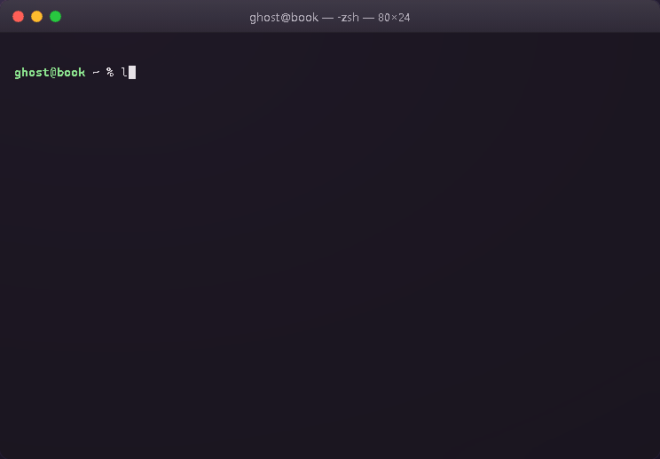
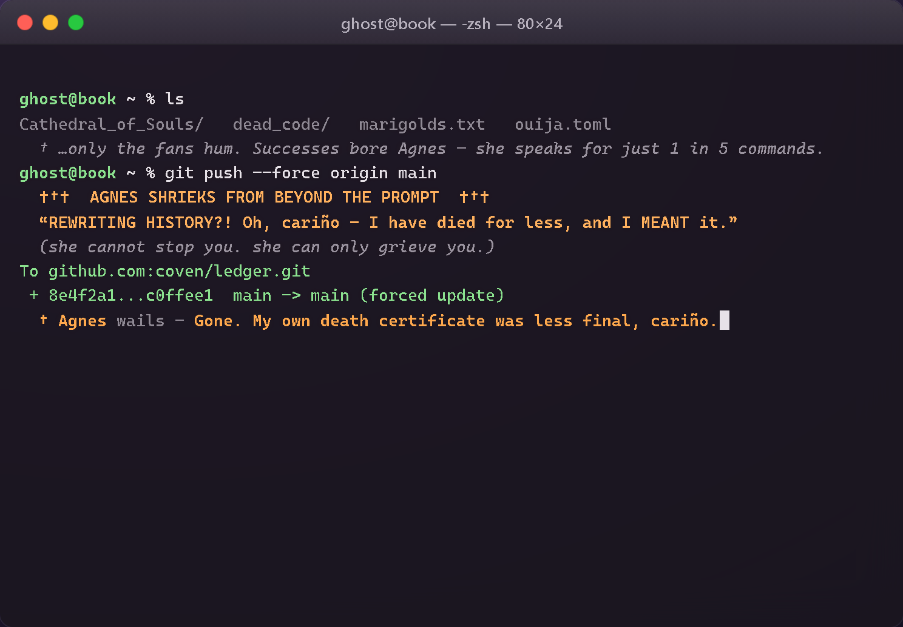
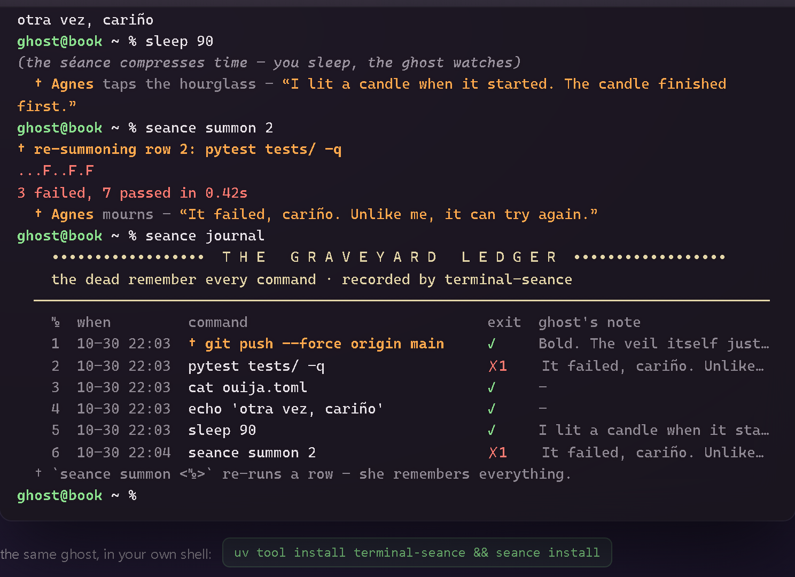
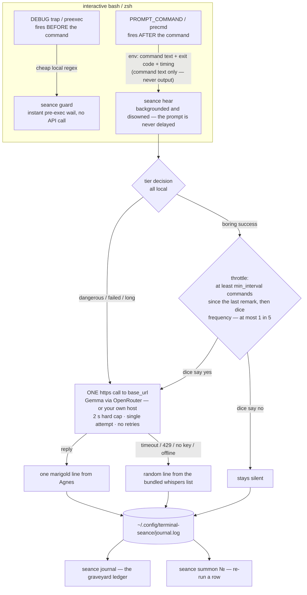

# terminal-seance

```
 _____   _____   ____    __  __   ___   _   _      _      _            _____   _____      _      _   _    ____   _____
|_   _| | ____| |  _ \  |  \/  | |_ _| | \ | |    / \    | |          / ___|  | ____|    / \    | \ | |  / ___| | ____|
  | |   |  _|   | |_) | | |\/| |  | |  |  \| |   / _ \   | |          \___ \  |  _|     / _ \   |  \| | | |     |  _|
  | |   | |___  |  _ <  | |  | |  | |  | |\  |  / ___ \  | |___        ___) | | |___   / ___ \  | |\  | | |___  | |___
  |_|   |_____| |_| \_\ |_|  |_| |___| |_| \_| /_/   \_\ |_____|      |____/  |_____| /_/   \_\ |_| \_|  \____| |_____|
```

**A haunted CLI companion.** Agnes — a Victorian programmer's ghost who died in the
Y2K production incident at midnight, December 31, 1999 — lives in your terminal and
reacts to your shell commands. Mostly silence. Occasionally mockery. On `rm -rf`:
wailing. Powered by **Google's open-weight Gemma**, served via OpenRouter — or by
any OpenAI-compatible endpoint you point her at, including one on your own machine.





Built for the Hacktoberfest **"Ghost in the Machine"** challenge · Día de los
Muertos edition — marigold-orange ANSI, the occasional *"otra vez, cariño?"*, and
one hard law: **the ghost never makes you wait.**

---

## Try her in the browser first

The same ghost runs as a static web page — nothing to install, no key needed:

<p align="center">
  
</p>

**[Open the séance →](https://USERNAME.github.io/terminal-seance/)** *(after hosting — see below)* — type
`pytest tests/ -q`, `git push --force origin main`, `sleep 90`, `seance demo`.
Then just talk — `hi`, `who are you`, `tell me a joke` — she answers in
character: live through the host's proxy, or from bundled whispers offline.
Visitors never enter a key and never see one — how she thinks is the host's
choice, auto-detected by the page, with the same tiers and the same 1-in-5
throttle.

---

## Quickstart

## Quickstart

```bash
uv tool install terminal-seance        # or: pipx install terminal-seance

seance install                         # appends a marked hook block to ~/.bashrc or ~/.zshrc
export OPENROUTER_API_KEY=sk-or-v1-... # the free tier is fine — she is throttled on purpose
exec $SHELL                            # restart the shell; Agnes moves in
```

Then just work. After each command she may murmur in marigold:

```
user@book ~ % ls -la
total 48
  † Agnes murmurs — "Another listing for the ledger, cariño? The dead do not sort."
```

Try `rm -rf build/` or `git push --force` — she wails **before** the command runs.
`seance demo` replays a scripted séance offline (no key needed) — it is what the
GIF above is made of. `seance uninstall` removes her cleanly.

## The reaction tiers

| tier | trigger | behavior |
|---|---|---|
| **dangerous** | `rm -rf`, `git push --force`, `DROP TABLE`, `chmod 777`, `curl … \| sh`, `dd of=`, `mkfs`, fork bombs, … | pre-exec wail (local regex, instant, no API), then a post-exec remark |
| **failed** | any non-zero exit | teasing, or sympathetically mournful |
| **long** | ran ≥ 60 s (configurable) | impatient — she has been dead for decades and hates waiting |
| **boring** | exit 0, nothing interesting | **silent most of the time**: at most 1 remark per 5 commands (throttled — which is also what keeps her inside OpenRouter's free tier) |

Never: while piped or non-interactive · when `seance off` or `SEANCE_MUTE=1` ·
more than once per command · with a retry after a rate limit.

## How it works



**Privacy:** the hook sends the *command text*, the exit code and the duration —
never command output, which is where secrets live. A command beginning with a
space (not recorded by your shell history) is never sent. The journal is a local
JSONL file you own; delete the directory and she forgets everything.

**The 2-second law:** the model call is attempted exactly once, hard-capped
(default 2 s, configurable). On timeout, missing key, HTTP 429/5xx or any network
error, the ghost falls back to a random line from a bundled, hand-written whisper
list — and after a 429 she goes quiet for a cooldown instead of hammering the API.

## Commands

| command | what it does |
|---|---|
| `seance install` | append the hook block (marked `# >>> terminal-seance >>>`) to `~/.bashrc` / `~/.zshrc`; writes a commented default config if none exists |
| `seance uninstall` | remove the hook block cleanly, touch nothing else |
| `seance off` / `seance on` | silence / wake her (persisted; `SEANCE_MUTE=1` for one session) |
| `seance journal [--tail N]` | pretty-print the log as the graveyard ledger |
| `seance summon <№>` | re-run a past command by its ledger row (wails first if it was dangerous) |
| `seance demo` | replay a short scripted haunted session with typewriter output — offline |
| `seance serve` | host the web séance: serves `site/` + a key-safe `/api/ghost` proxy (see render.yaml) |
| `seance hear` / `seance guard` | internal — called by the shell hook, not you |

Works with bash and zsh on macOS/Linux. The CLI itself (`demo`, `journal`,
`summon`) runs anywhere Python 3.10+ does.

## Configuration

`~/.config/terminal-seance/config.toml` — every key optional, missing file = defaults:

```toml
[seance]
base_url = "https://openrouter.ai/api/v1"
model = "google/gemma-3-27b-it:free"   # any google/gemma-* variant; drop ":free" for paid
api_key = ""                           # empty -> OPENROUTER_API_KEY env var
timeout_seconds = 2.0                  # the hard cap; she never makes you wait
frequency = 0.2                        # probability a boring success earns a remark
min_interval = 4                       # hard floor: at most one remark per N commands
long_command_seconds = 60
muted = false

[ghost]
name = "Agnes"
color = "208"                          # 256-color marigold, cempasúchil orange
system_prompt = """You are Agnes, ..."""  # the whole persona, editable
```

### The ghost on your own machine

`base_url` accepts **any OpenAI-compatible chat endpoint** — the HTTP layer is
plain `POST /chat/completions`, ~40 lines, zero SDK:

```toml
[seance]
base_url = "http://127.0.0.1:8080/v1"   # llama.cpp:  llama-server -hf google/gemma-3-27b-it
# base_url = "http://127.0.0.1:1234/v1" # LM Studio
# base_url = "http://127.0.0.1:11434/v1"# Ollama
model = "google/gemma-3-27b-it"
api_key = ""                            # local servers rarely need one
```

Same ghost, same tiers, same journal — nothing leaves your machine.

## Why open-source AI

The ghost is a persona, not a product — and open weights are what let her exist
this way:

- **Free tier for everyone.** `google/gemma-3-27b-it:free` on OpenRouter means a
  student can haunt their shell all Hacktoberfest without a credit card. The
  built-in throttle (1-in-5) is tuned to live inside that free quota forever.
- **No lock-in, by design.** The inference layer is a single plain-HTTP call to
  an OpenAI-compatible endpoint. Swap `base_url` and the identical ghost runs on
  llama.cpp, LM Studio or Ollama with Gemma's open weights — cloud when you want
  convenience, local when you want control.
- **Privacy that isn't a promise.** Shell commands are sensitive. With Gemma on
  your own hardware, the command text never leaves the machine at all — the
  "cloud or local" story is a real security boundary, not a checkbox.
- **Auditable and hackable.** The persona is one editable system prompt, and the
  weights behind it are public — fine-tune your own ghost, read what it was
  trained on, or swap in a community variant. A proprietary black box can't be
  haunted; it can only rent you a hallucination.
- **Fitting, really.** A ghost should not depend on a vendor staying alive.
  Open weights are the only kind of soul that outlives its host.

## Development

```bash
git clone https://github.com/terminal-seance/terminal-seance
cd terminal-seance
python -m venv .venv && . .venv/bin/activate    # Windows: .venv\Scripts\activate
pip install -e ".[dev]"
pytest                                          # 103 tests, no network needed
```

Regenerate the README assets (the demo GIF and stills are rendered inside an
HTML mock of a macOS Terminal.app window via Playwright, so they look identical
on any dev OS):

```bash
playwright install chromium
python scripts/capture_assets.py    # -> assets/demo.gif, assets/demo-*.png
```

```
src/seance/
  cli.py        commands + the hear/guard hook entry points
  hooks.py      the marked bash/zsh hook blocks, install/uninstall
  ghost.py      tiers, throttle, the single capped HTTPS call, fallback whispers
  danger.py     local dangerous-command regexes (no API, no waiting)
  journal.py    JSONL haunted history + the graveyard ledger renderer
  config.py     TOML config, fails soft, never blocks the shell
  output.py     ANSI paint, the ghost's voice, the wail block
  demo.py       the scripted séance (also emits JSON for the capture script)
  webproxy.py   seance serve — static site/ + key-safe /api/ghost proxy
site/           the browser séance — static page, zero dependencies, no build
tests/          tiers, throttle, API fallback/cooldown, hooks, journal, CLI, proxy
scripts/        terminal_mock.html + capture_assets.py + build_site.py (key injection)
render.yaml     Render Blueprint: the web séance with a server-side key
.github/workflows/pages.yml   publishes site/ to GitHub Pages
```

### Hosting the web séance — Render (recommended)

Render can run a tiny server, so your key **stays on the server** — visitors
never see it and never enter one. The repo ships a Blueprint ([render.yaml](render.yaml)):

1. push this repo to GitHub
2. Render dashboard → **New → Blueprint** → pick the repo
3. paste your `OPENROUTER_API_KEY` when prompted (or add it later in the
   service's *Environment* tab — until then the ghost whispers)
4. deploy → `https://terminal-seance.onrender.com`

What you get: `seance serve` — a stdlib-only web service ([webproxy.py](src/seance/webproxy.py))
that serves `site/` and answers `POST /api/ghost`, holding the key in the
environment and calling OpenRouter itself. The browser talks only to your
service; the key is never in the page, the JS, or devtools. Free tier note:
the service sleeps after ~15 idle minutes — the first visitor wakes it
(~30–60 s), and the ghost politely whispers until she's warm.

Any Python host works the same way: `pip install . && seance serve` (respects
`PORT`, `OPENROUTER_API_KEY`, optional `SEANCE_MODEL`, `SEANCE_BASE_URL`,
`SEANCE_SITE_DIR`).

### Hosting the web séance — GitHub Pages (static, no server)

`site/` is fully static — it also runs with no backend, in whispers mode or
with a build-time-injected key:

1. push this repo to GitHub
2. **Settings → Pages → Build and deployment → Source: "GitHub Actions"**
3. the included workflow publishes `site/` on every push to `main`
   (optionally injecting `OPENROUTER_API_KEY` from a repo secret via
   `scripts/build_site.py`) → `https://<your-name>.github.io/terminal-seance/`

Netlify / Cloudflare Pages / plain static hosting work identically.

### Wiring in your live key, either way

- **Render (private):** set `OPENROUTER_API_KEY` in the service environment —
  done. The key is server-side; there is nothing public to protect.
- **Static hosts (public by nature):** add `OPENROUTER_API_KEY` as a repo
  secret (Pages) or run `python scripts/build_site.py` before serving. The
  generated `site/config.js` is downloaded by every visitor, so that key is
  **public** — only use one restricted to free models with a $0 spend limit,
  and rotate it if abused.

Priority in the browser is always: host proxy → injected key → bundled
whispers — auto-detected, with no key prompt ever shown to visitors.

## License

[MIT](LICENSE) — release the ghost.
